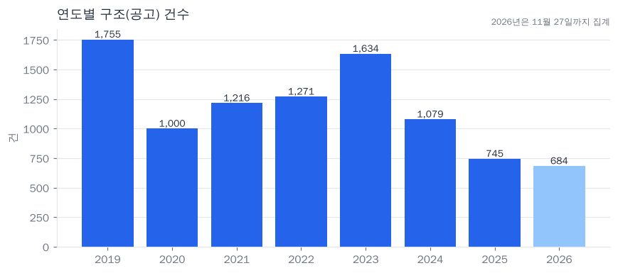
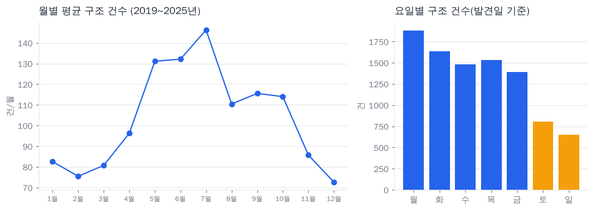
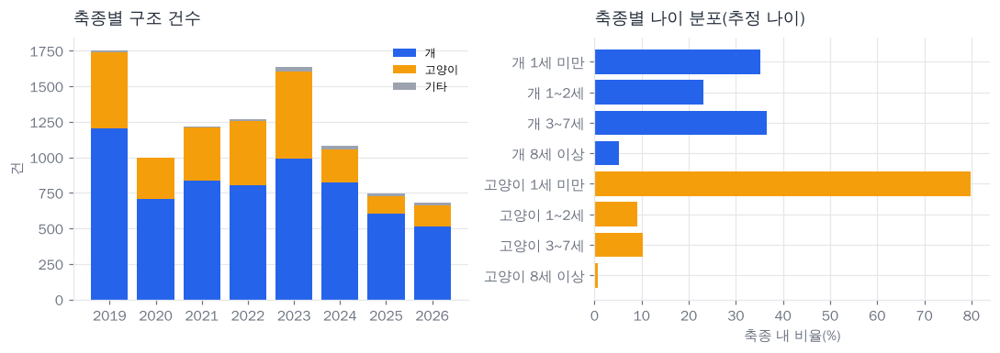
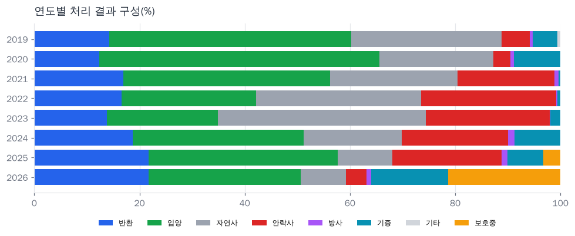
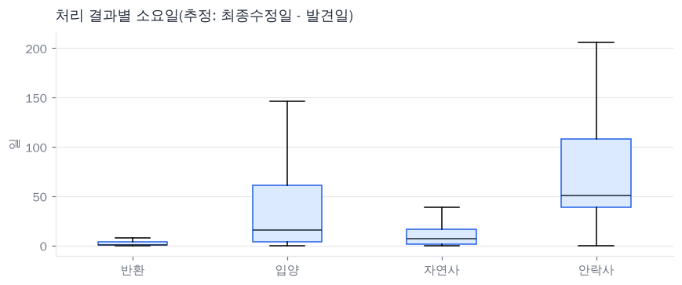
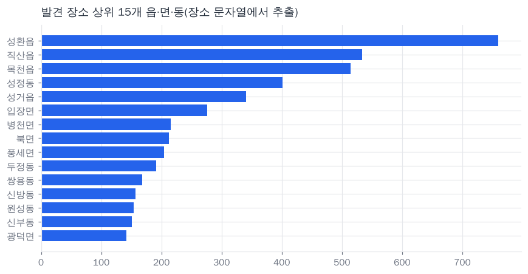
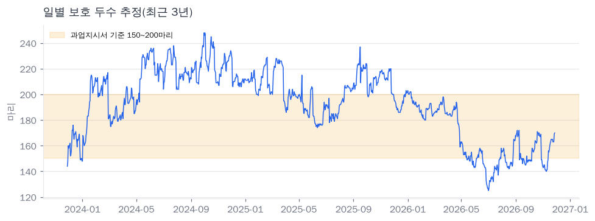

# 천안시 유기·유실동물 1차 데이터 분석

- 분석 기준: 「2027년 천안시 유기·유실동물 구조(포획) 용역 과업지시서」, 선행연구 검토 결과(`review/`)
- 데이터: 농림축산검역본부 국가동물보호정보시스템 구조동물 조회 API(공공데이터포털), KOSIS 천안시 주민등록인구
- 기간: 2019-01-01 ~ 2026-11-27 (발견일 기준) · 생성일: 2026-11-28
- 수집 9,384건 → 형식 오류 0건·중복 0건 제외 → **분석 9,384건**
- 수집 완결성: 95개월 모두 API 총건수와 수집 건수 일치 여부 확인 (불일치 0개월)
- 원천 누락: API가 총건수에는 포함하지만 목록으로는 제공하지 않는 공고 2건(2021-05 1건, 2023-02 1건). 조회 조건을 바꿔도 받을 수 없어 분석에서 빠졌어요(전체의 0.02%).

> 이 보고서의 수치는 `pipeline/analyze.py`가 데이터에서 직접 계산한 값이에요. '추정'이라고 표시한 지표는 API에 해당 항목이 없어 다른 항목으로 근사한 값이라 해석에 주의가 필요해요.

## 1. 구조 규모 (과업지시서 제3조·제6조)



| 연도 | 구조 건수 | 집계 일수 | 일평균 | 인구 | 인구 1천명당 |
|---|---|---|---|---|---|
| 2019 | 1,755 | 365 | 4.8 | 652,258 | 2.69 |
| 2020 | 1,000 | 366 | 2.7 | 658,808 | 1.52 |
| 2021 | 1,216 | 365 | 3.3 | 658,486 | 1.85 |
| 2022 | 1,271 | 365 | 3.5 | 657,559 | 1.93 |
| 2023 | 1,634 | 365 | 4.5 | 655,959 | 2.49 |
| 2024 | 1,079 | 366 | 2.9 | 659,920 | 1.64 |
| 2025 | 745 | 365 | 2.0 | 664,322 | 1.12 |
| 2026 | 684 | 331 | 2.1 | 미공표 | - |

- 전체 연도 중 구조 건수가 가장 많았던 해는 **2019년(1,755건)**이에요.
- 최근 3개 완결 연도(2023~2025년)의 일평균은 **3.2건**이에요. 과업지시서의 구조 전담 인력 최소 3인·2인 1조(제6조), 신고 후 3시간 이내 포획(제7조) 기준을 검토할 때 기초 수요로 쓸 수 있어요.
- 2026년은 331일 동안 684건(일평균 2.1건)이에요.

관련 선행연구(입소 추이·인구 대비 지표):
- Stavisky 외 (2012). Demographics and economic burden of un-owned cats and dogs in the UK: results of a 2010 census. *BMC Veterinary Research*. https://doi.org/10.1186/1746-6148-8-163
- Brown 외 (2013). Effects of Phenotypic Characteristics on the Length of Stay of Dogs at Two No Kill Animal Shelters. *Journal of Applied Animal Welfare Science*. https://doi.org/10.1080/10888705.2013.740967
- Protopopova 외 (2014). In-Kennel Behavior Predicts Length of Stay in Shelter Dogs. *PLoS ONE*. https://doi.org/10.1371/journal.pone.0114319

## 2. 계절·요일 분포 (과업지시서 제3조⑦ 365일 운영)



- 월평균이 가장 많은 달은 **7월(146.3건)**, 가장 적은 달은 **12월(72.6건)**이에요. 차이는 약 2.0배예요.
- 주말(토·일) 발견이 전체의 **15.6%**예요(요일이 고르면 28.6%). 주말에도 구조 수요가 있어 365일 운영(제3조⑦)의 근거가 돼요. 단, 발견일은 공고에 적힌 날짜라 실제 신고 시각과 다를 수 있어요.

## 3. 구조 동물 특성



- 전체 기간 축종 구성: 개 6,488건(69.1%), 고양이 2,759건(29.4%), 기타 137건(1.5%)
- 개의 **35.1%**가 1세 미만(추정 나이)이에요.
- 고양이의 **79.9%**가 1세 미만(추정 나이)이에요.
- 중성화 여부가 기록된 7,350건 중 중성화된 동물은 **9.5%**예요.

## 4. 처리 결과 (과업지시서 제3조⑤·⑥)



| 연도 | 반환 | 입양 | 자연사 | 안락사 | 방사 | 기증 | 기타 | 보호중 |
|---|---|---|---|---|---|---|---|---|
| 2019 | 14.2 | 46.0 | 28.5 | 5.4 | 0.6 | 4.7 | 0.6 | 0.0 |
| 2020 | 12.3 | 53.3 | 21.7 | 3.2 | 0.7 | 8.8 | 0.0 | 0.0 |
| 2021 | 16.9 | 39.3 | 24.2 | 18.4 | 0.7 | 0.4 | 0.0 | 0.0 |
| 2022 | 16.6 | 25.6 | 31.4 | 25.6 | 0.2 | 0.6 | 0.0 | 0.0 |
| 2023 | 13.8 | 21.1 | 39.4 | 23.6 | 0.1 | 1.9 | 0.0 | 0.0 |
| 2024 | 18.7 | 32.4 | 18.6 | 20.3 | 1.2 | 8.7 | 0.0 | 0.0 |
| 2025 | 21.7 | 36.0 | 10.3 | 20.8 | 1.1 | 6.8 | 0.0 | 3.2 |
| 2026 | 21.8 | 28.8 | 8.6 | 3.9 | 0.9 | 14.6 | 0.0 | 21.3 |

- 완결 연도(2019~2025년) 종료 건 8,676건 기준: 입양 35.8%, 자연사 26.9%, 안락사 16.6%, 반환 15.9%, 기증 4.1%, 방사 0.6%, 기타 0.1%.
- 개: 반환 22.4%, 입양 36.4%, 자연사 12.7%, 안락사 22.5%
- 고양이: 반환 1.5%, 입양 32.9%, 자연사 59.9%, 안락사 3.6%
- 2026년은 아직 '보호중'인 건이 포함돼 있어 다른 연도와 단순 비교하기 어려워요.

관련 선행연구(소유자 반환·동물등록):
- Lancaster 외 (2015). Problems Associated with the Microchip Data of Stray Dogs and Cats Entering RSPCA Queensland Shelters. *Animals*. https://doi.org/10.3390/ani5020332
- Kremer (2021). A New Web-Based Tool for RTO-Focused Animal Shelter Data Analysis. *Frontiers in Veterinary Science*. https://doi.org/10.3389/fvets.2021.669428
- Vučinić 외 (2015). Visibly Marked and Microchipped Lost Dogs Have a Higher Chance to Find Their Owners in Belgrade. *Macedonian Veterinary Review*. https://doi.org/10.14432/j.macvetrev.2014.12.035

## 5. 처리까지 걸린 기간 — 추정 (선행연구의 보호기간 지표)



| 처리 결과 | 건수 | 하위 25%(일) | 중앙값(일) | 상위 25%(일) |
|---|---|---|---|---|
| 반환 | 1,529 | 1.0 | 1.0 | 4.0 |
| 입양 | 3,185 | 4.0 | 16.0 | 61.0 |
| 자연사 | 2,387 | 2.0 | 7.0 | 17.0 |
| 안락사 | 1,438 | 39.0 | 51.0 | 108.0 |
| 방사 | 57 | 3.0 | 26.0 | 97.0 |
| 기증 | 329 | 11.0 | 57.0 | 161.0 |
| 기타 | 10 | 1.0 | 1.0 | 1.0 |

- API에는 실제 처리일이 없어서, 기록이 마지막으로 수정된 날(updTm)을 처리일로 근사했어요. 처리 후에 기록이 다시 수정되면 기간이 길게 잡힐 수 있으니 **참고용 추정치**로만 봐 주세요. 365일을 넘는 값은 제외했어요.

관련 선행연구(보호기간):
- Gunter 외 (2019). Evaluating the effects of a temporary fostering program on shelter dog welfare. *PeerJ*. https://doi.org/10.7717/peerj.6620
- Hawes 외 (2020). Factors Informing the Return of Adopted Dogs and Cats to an Animal Shelter. *Animals*. https://doi.org/10.3390/ani10091573

## 6. 발생 지역 (과업지시서 제3조② 관내 전 지역)



- 구별: 미상 3,744건(39.9%), 서북구 2,971건(31.7%), 동남구 2,669건(28.4%)
- 발견 장소 문자열에서 읍·면·동을 뽑을 수 있었던 건은 63.5%예요. 장소가 '○○아파트', '○○로' 등으로만 적힌 경우는 빠지므로 분포는 근사치예요.
- 상위 3곳: 성환읍(760건), 직산읍(533건), 목천읍(514건). 출동 거리·3시간 내 포획 기준(제7조)을 검토할 때 거점 배치 참고 자료가 될 수 있어요.

## 7. 보호 두수 추정 (과업지시서 2.3 다. 기준 마릿수 150~200마리)



- 최근 3년 추정 보호 두수: 평균 **193마리**, 최소 125마리, 최대 248마리(2024-09-30).
- 발견일부터 처리일(추정)까지 보호소에 있었다고 가정해 날마다 더한 값이에요. 처리일이 추정치라서 실제 보호 두수와 차이가 날 수 있어요. 센터 내부의 일일 보호 현황과 맞춰 보정하는 것이 좋아요.

## 8. 과업 요구사항 대비 데이터 공백

| 과업지시서 요구사항 | 공개 API로 확인 가능 여부 | 필요한 추가 자료 |
|---|---|---|
| 신고 접수 후 3시간 이내 포획, 긴급 1시간 이내 출동(제7조) | 불가 (신고·출동·포획 시각 없음) | 천안시 신고 접수·출동 일지 |
| 09:00~22:00 신고 접수, 2인 1조 근무(제6조) | 불가 (시각·인력 정보 없음) | 근무표, 시간대별 신고 기록 |
| 센터 도착 전 폐사 처리(제3조⑥) | 일부 (자연사 건수만, 도착 전·후 구분 없음) | 사체 처리 대장 |
| 교통사고 동물 후송·치료(제3조④) | 일부 (특이사항 문구에 의존) | 구조 사유 분류 기록 |
| 월별 처리실적 보고(제13조) | 가능 (월별 건수·처리 결과) | — |

## 9. 재현 방법

```bash
export DATA_GO_KR_KEY='공공데이터포털 인증키'
export KOSIS_API_KEY='KOSIS 인증키'
python pipeline/run_all.py
```

산출물: `data/processed/cheonan_rescues.csv`(정제 데이터), `analysis/tables/*.csv`(표), `analysis/figures/*.png`(그림)
